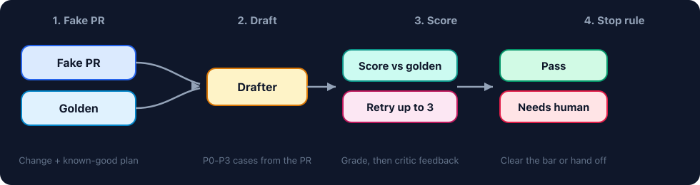

# 🔁 Loop Lab

A tiny dashboard that **drafts a P0–P3 test plan** from a fake PR, **scores it against a golden**, retries with critic feedback, then **passes or escalates to a human** after 3 attempts.

**Live demo:** https://loop-lab-loops.vercel.app/

## How the flow works



| Step | Color | What it is |
|------|-------|------------|
| **1 · Fake PR** | Blue | A made-up change plus the golden plan you would sign |
| **2 · Draft** | Amber | Drafter writes P0–P3 cases from the PR only (not the golden) |
| **3 · Score** | Teal / pink | Compare to the golden. Under 80%? Retry with the critic list, max 3 |
| **4 · Stop rule** | Green / red | **Pass**, or **Needs human** |

If it cannot score itself, it is not a loop.

## What problem this solves

Other labs in this portfolio **do a job once** (risk, tests, gate, live window). This one adds the missing piece: **who grades the AI.**

A loop is not a prompt. It is: do the work, score it, retry, then pass or hand it to a person. Remember what improved.

## The five fake PRs

| PR | Platform | What you should see |
|----|----------|---------------------|
| **#1042 Login + Remember me** | Web | Teaching story. Attempt 1 = **62%**, attempt 2 = **88%**, **Pass** |
| **#1108 CTV player resume** | CTV | Still under the bar after 3 tries. **Needs human** plus a hypothetical RCA brief |
| **#1184 iOS breaking-news push** | iOS | Misses cold start and stale story, then **Pass** |
| **#1210 Android saved articles** | Android | Covers the golden on attempt 1. **Pass** |
| **#1276 Web live blog** | Web | Keeps place + shows errors on retry. **Pass** |

Passwordless / magic-link gated articles are **not** in this lab. That is a separate project.

## Quick start

**Prerequisites:** Node.js 18+

```bash
git clone https://github.com/ramonacraft/loop-lab.git
cd loop-lab
npm install
npm test
npm run dev
```

Open the URL Vite prints (usually `http://localhost:5173`).

You should see five fake PRs on the left and the login teaching story selected.

## How to walk the product

1. Read [docs/PAPER_WALKTHROUGH.md](docs/PAPER_WALKTHROUGH.md) (the login story on paper)
2. On the login PR, click **Run attempt 1** — expect **62%**. Then click **Retry with critic** — expect **88% Pass**
3. Click the CTV player PR. Run three times — expect **Needs human** after attempt 3, then a **Human brief** with theory, a fast confirm, and a fix path
4. Try Android saved articles — expect **Pass** on attempt 1 (not every change needs a retry)

No API key. The drafter and scorer are deterministic so anyone who runs it gets the same screenshot every time.

## Stack

- Vite + React 19 + TypeScript
- Loop engine in `src/engine/` (draft, score, retry, history)
- Fake PRs and goldens in `src/data/fixtures.ts`
- Run history in this browser only (`localStorage`)

## Project layout

```text
src/
  components/   PR list, golden, attempts, verdict, history
  data/         Five fake PRs and goldens
  engine/       Drafter, scorer, loop, history
  types/        Shared types
docs/
  PAPER_WALKTHROUGH.md
  flow.png
```

## Related work

- [Weekly Risk Radar](https://github.com/ramonacraft/weekly-risk-radar) — what might break
- [Release Gate Lab](https://github.com/ramonacraft/release-gate-lab) — can we ship?
- [Live Event War Room](https://github.com/ramonacraft/live-event-war-room) — is the live window healthy?

Those do a job once. This lab grades the agent.

## Notes / Privacy

- **Published by** [Ramona Bonitatis](https://github.com/ramonacraft).
- **Default: no secrets.** This app runs with an empty or commented `.env`. `.env.example` has no tokens.
- Fake PRs, goldens, and scores are local sample data. Nothing here is a real GitHub org, customer, or employer change.
- Run history stays in your browser. It is not sent anywhere.
- See [AGENTS.md](./AGENTS.md) for contributor conventions in Cursor.
